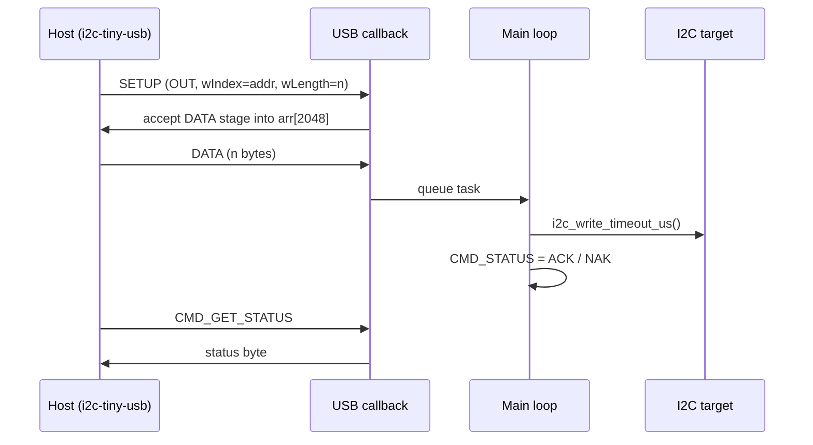
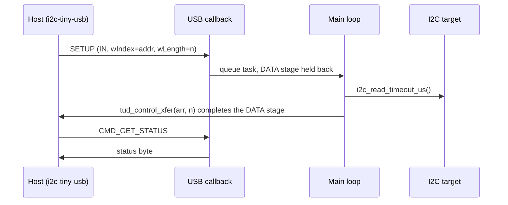

# i2c_rp2040

Bare-metal USB-to-I2C bridge firmware for the Raspberry Pi Pico (RP2040), written in C on
top of the Pico SDK and TinyUSB.

The Pico enumerates as an [i2c-tiny-usb](https://github.com/harbaum/I2C-Tiny-USB) compatible
device (USB ID `0403:c631`), with hand-written USB descriptors and its own implementation of the
i2c-tiny-usb vendor control protocol. Because the device looks exactly like the real adapter to
the host, the stock Linux `i2c-tiny-usb` kernel driver binds to it automatically and exposes it
as a regular `/dev/i2c-N` bus. No custom host software or kernel module is needed.

Everything on the host side (`i2c-tools`, Python `smbus`, kernel IIO sensor drivers) works
unmodified on top of this firmware.

## Highlights

- **Custom USB device stack configuration:** device, configuration and string descriptors
  written from scratch, with a single vendor-specific interface
- **i2c-tiny-usb protocol implemented from the spec:** functionality query, status polling and
  I2C transfers with explicit START/STOP control, carried in USB control requests on EP0
- **Deferred task architecture:** USB callbacks only capture the request, and the blocking I2C
  transaction runs later in the main loop, so USB handling is never blocked
- **ACK/NAK reporting back to the host:** the kernel driver finds out whether the target answered,
  so `i2cdetect` scanning works
- **Repeated start support:** combined write-then-read transactions (register reads) go out
  without a STOP in between
- **Up to 2048 bytes per transfer:** enough for a full SSD1306 128x64 frame in one write
- **Low idle power:** the core sleeps in `__wfi()` when no USB events are pending

## Architecture

### USB device layer — `src/usb_descriptor.c`

| Descriptor    | Contents |
|---------------|----------|
| Device        | USB 2.0, class `0x00` (defined per interface), VID `0x0403`, PID `0xc631`, 1 configuration |
| Configuration | 1 interface, 100 mA, one vendor-class interface (`TUD_VENDOR_DESCRIPTOR`) |
| Strings       | Language `0x0409`, manufacturer, product `USB-I2C Bridge`, serial number |

The VID/PID pair is what makes the Linux driver bind: `i2c-tiny-usb` matches on
`0403:c631`. String descriptors are converted from ASCII to UTF-16LE by hand in
`tud_descriptor_string_cb`, without any helper library.

All traffic goes over **control transfers on endpoint 0**, handled in
`tud_vendor_control_xfer_cb`. The bulk endpoints declared by the vendor interface are unused.

### Protocol — `include/commands.h`

| `bRequest` | Command | Direction | Firmware behaviour |
|-----------:|---------|-----------|--------------------|
| 1 | `CMD_GET_FUNC`   | IN  | Returns the functionality bitmask `0x0EFF0009` (`I2C_FUNC_I2C \| I2C_FUNC_SMBUS_EMUL`) |
| 2 | `CMD_SET_DELAY`  | OUT | Acknowledged. The bus speed stays fixed at 100 kHz |
| 3 | `CMD_GET_STATUS` | IN  | Returns the result of the last transfer: `0` idle, `1` address ACK, `2` address NAK |
| 4 | `CMD_I2C_IO`                   | IN/OUT | Transfer in the middle of a transaction (no STOP) |
| 5 | `CMD_I2C_IO \| BEGIN`          | IN/OUT | First message of a transaction (no STOP) |
| 6 | `CMD_I2C_IO \| END`            | IN/OUT | Last message, ends with STOP |
| 7 | `CMD_I2C_IO \| BEGIN \| END`   | IN/OUT | Single-message transaction, ends with STOP |

For I2C transfers, `wIndex` carries the 7-bit target address, `wLength` the byte count, and
the request direction (`bmRequestType`) chooses between read and write. When `END` is not set,
the firmware leaves the bus without a STOP, so the next message starts with a repeated START.
This is how `i2ctransfer w1@0x68 0x75 r1` and SMBus register reads work.

### Deferred task model — `include/task_manager.h`, `src/main.c`

I2C transactions block, and with a 100 ms timeout per transfer they can take long. Running them
inside the TinyUSB callback would stall the USB stack. So the callback only **captures** the
request into a single-slot task (`task_manager`), and the main loop **executes** it:

```c
typedef struct {
    bool needs_to_handle;            // a transfer is waiting to run
    uint8_t rhport;                  // USB port to reply on
    tusb_control_request_t request;  // copy of the SETUP packet
} task_manager;
```

```
main loop:
    tud_task()                     → TinyUSB processes events, calls the vendor callback
    if task.needs_to_handle:
        handle_all(task)           → I2C read or write via hardware_i2c
        CMD_STATUS = ACK / NAK     → kept for the next CMD_GET_STATUS
        task.needs_to_handle = false
    if no USB events pending:
        __wfi()                    → sleep until the next interrupt
```

### Transfer flows

**Write (host → target), OUT request:**



**Read (target → host), IN request:**



For reads, the control transfer stays open until the main loop has the data from the bus and
answers it. While a transfer is still waiting to run, the firmware does not reply to
`CMD_GET_STATUS`, so the host can't read a stale status.

Requests with `wLength` > 2048 are rejected with a STALL.

### Source layout

```
include/
  commands.h         i2c-tiny-usb command codes and status values
  task_manager.h     deferred task slot shared by the USB callback and the main loop
  i2c_handler.h      I2C pins, speed and handler API
  tusb_config.h      TinyUSB configuration (device mode, one vendor interface)
src/
  main.c             init (TinyUSB, I2C, GPIO) and the main loop
  usb_descriptor.c   USB descriptors and vendor control request handling
  i2c_handler.c      I2C read/write execution with START/STOP control
scripts/             demo scripts for real devices (see below)
```

## Hardware

### Wiring

| Pico pin | GPIO | Function |
|----------|------|----------|
| Pin 21   | GP16 | SDA (`i2c0`) |
| Pin 22   | GP17 | SCL (`i2c0`) |
| Pin 36   | —    | 3V3 |
| Pin 38   | —    | GND |

The bus runs at **100 kHz**. Pins and speed are set in
[`include/i2c_handler.h`](include/i2c_handler.h).

> **Pull-ups:** the firmware does not enable the RP2040 internal pull-ups. Add external
> pull-up resistors (10 kΩ tested) from SDA and SCL to 3V3.

### Tested with

- Raspberry Pi Pico
- BME280 (temperature / humidity / pressure), also through the kernel `bmp280_i2c` IIO driver
- MPU-6050 (accelerometer / gyroscope)
- SSD1306 128x64 OLED, including full-frame 1 KB writes

## Building

Requirements:

- [Pico SDK](https://github.com/raspberrypi/pico-sdk) **2.2.0 or later**
- CMake ≥ 3.25, Ninja
- `arm-none-eabi-gcc` toolchain
- [`picotool`](https://github.com/raspberrypi/picotool) (optional, for flashing from the command line)

The presets expect the SDK at `/opt/pico-sdk`. If yours is elsewhere, change `PICO_SDK_PATH` in
[`CMakePresets.json`](CMakePresets.json) or override it on the command line.

```sh
cmake --preset release        # or: debug
cmake --build --preset release
```

The firmware is written to `build/release/src/i2c_rp2040.uf2`.

## Flashing

**With picotool:**

```sh
cmake --build --preset release --target load
```

**Manually:** hold BOOTSEL while plugging in the Pico, then copy `i2c_rp2040.uf2` to the
`RPI-RP2` drive.

## Usage on Linux

After plugging in the Pico, check that it was detected:

```sh
lsusb | grep 0403:c631
i2cdetect -l                 # look for the "i2c-tiny-usb" bus
```

Note the bus number (`i2c-N`), then scan it:

```sh
sudo modprobe i2c-dev        # if /dev/i2c-* does not exist yet
i2cdetect -y N
```

Read and write registers as usual:

```sh
i2cget -y N 0x76 0xd0                     # BME280 chip ID (0x60)
i2ctransfer -y N w1@0x68 0x75 r1          # MPU-6050 WHO_AM_I (0x68)
```

You need root, or your user must be in the group that owns `/dev/i2c-*` (often `i2c`).

## Demo scripts

The [`scripts/`](scripts) directory has small Bash demos that use the bridge with real
devices. Each script hardcodes `BUS=8` and the device address at the top, so **change `BUS` to
your bus number** first.

| Script | Device | What it does | Extra dependencies |
|--------|--------|--------------|--------------------|
| `bme.sh`  | BME280 @ `0x76`  | Loads the kernel `bmp280_i2c` driver and shows live T / RH / P from IIO sysfs | `sudo` |
| `mpu.sh`  | MPU-6050 @ `0x68` | Wakes the sensor and shows live accel / gyro / temperature | `i2c-tools` |
| `oled.sh` | SSD1306 @ `0x3c`  | Streams your Wayland screen to a 128x64 OLED | `i2c-tools`, `grim`, ImageMagick 7 (`magick`) |

```sh
bash scripts/mpu.sh
```

Press `Ctrl+C` to stop (`oled.sh` turns the display off on exit).

## License

[MIT](LICENSE) © 2026 David L. (firewalldavid)
